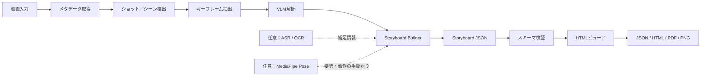
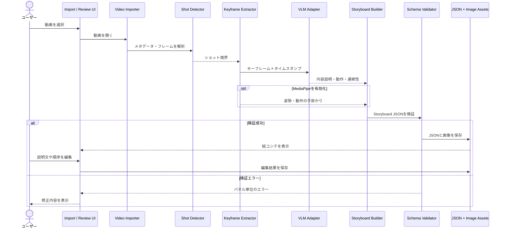

# video2storyboard

動画から、ショット単位の**絵コンテ（Storyboard）**を自動生成するための設計・実装プロジェクトです。動画を紙芝居動画に変換するのではなく、映像の流れを確認・編集できる「絵コンテ資料」を作ることを目的にします。

## 目的

- 動画を読み込み、シーン／ショットの境界を検出する
- 各ショットを代表するキーフレームを抽出する
- VLM（Vision-Language Model）で画面内容、動作、登場物、場面の連続性を説明する
- 構造化された Storyboard JSON と画像アセットを生成する
- HTMLビューアでパネル、説明文、順序を確認・編集し、各形式へ出力する

## 処理の流れ

1. **動画入力** — MP4 / MOV / WebM などを読み込み、FPS・長さ・解像度を取得
2. **ショット検出** — シーンの切り替わりを検出
3. **キーフレーム抽出** — 各ショットを代表するフレームを選び、重複や品質の低い画像を除外
4. **VLM解析** — フレームの内容、人物・物体、動作、構図、ショット間の連続性を文章化
5. **Storyboard生成** — タイムスタンプとキーフレームを紐づけ、Storyboard JSONを構築
6. **検証とレビュー** — スキーマ、時刻、画像参照を検証し、HTMLビューアで編集
7. **エクスポート** — JSON / HTML / PDF / PNG などの出力を想定

音声認識（ASR）やOCRは、台詞・字幕・画面内テキストを補足する任意の入力です。MediaPipe Poseも任意で利用でき、姿勢・動きの手掛かりを追加します。MediaPipeはVLMの代替ではなく、一般的な画面理解はVLMが担当します。

## システム構成図

SVGはREADME内でそのまま表示されます。Mermaidソースも併記しているため、GitHub上で表示を確認したり、図を編集したりできます。

- [SVGを開く](docs/v2s-architecture.svg)
- [Mermaidソース（.mmd）](docs/v2s-architecture.mmd)
- [PlantUMLソース（.puml）](docs/v2s-architecture.puml)

### Mermaidソース

## シーケンス図

こちらは、動画を選択してから絵コンテをレビュー・保存するまでのコンポーネント間のやり取りを示します。検証に失敗した場合は、不正なデータを確定せず、パネル単位のエラーをビューアへ返す設計です。

- [SVGを開く](docs/v2s-sequence.svg)
- [Mermaidソース（.mmd）](docs/v2s-sequence.mmd)
- [PlantUMLソース（.puml）](docs/v2s-sequence.puml)

### Mermaidソース

## 出力データの考え方

Storyboard JSONを正規データ（canonical artifact）として扱い、ビューアやエクスポーターはこのデータを読み書きする構成を目指します。画像はアセットとして別管理し、JSONから参照します。

各パネルに保持する情報の候補：

- パネルIDとショット番号
- 開始・終了タイムスタンプ
- キーフレーム画像の参照先
- 画面の説明、動作、登場物、構図
- 必要に応じた台詞・字幕・音声情報
- 解析モデル、生成日時、信頼度などのメタデータ

具体的なJSONスキーマ、VLMプロバイダー、ショット検出方式、HTMLビューアの実装は、今後の実装段階で確定します。上記の図は現時点の目標アーキテクチャです。

## 図のソース

| 種類 | 構成図 | シーケンス図 |
|---|---|---|
| Mermaid | [`v2s-architecture.mmd`](docs/v2s-architecture.mmd) | [`v2s-sequence.mmd`](docs/v2s-sequence.mmd) |
| SVG | [`v2s-architecture.svg`](docs/v2s-architecture.svg) | [`v2s-sequence.svg`](docs/v2s-sequence.svg) |
| PlantUML | [`v2s-architecture.puml`](docs/v2s-architecture.puml) | [`v2s-sequence.puml`](docs/v2s-sequence.puml) |
