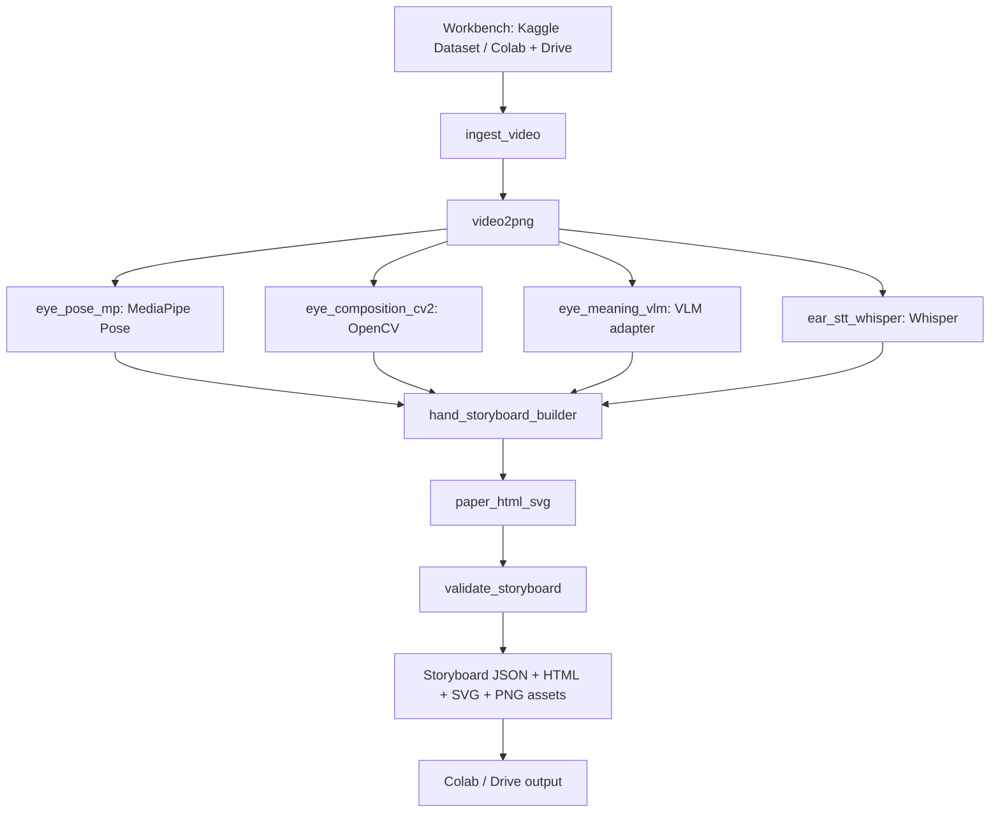
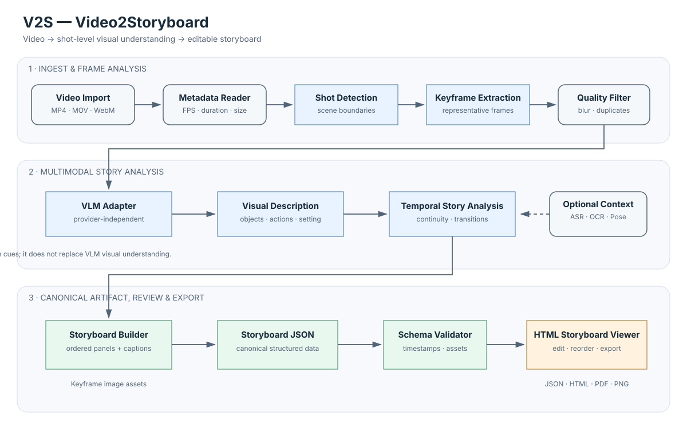
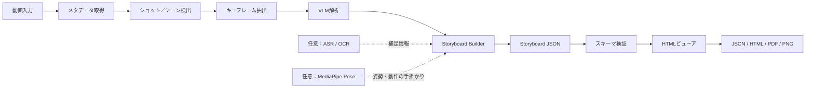
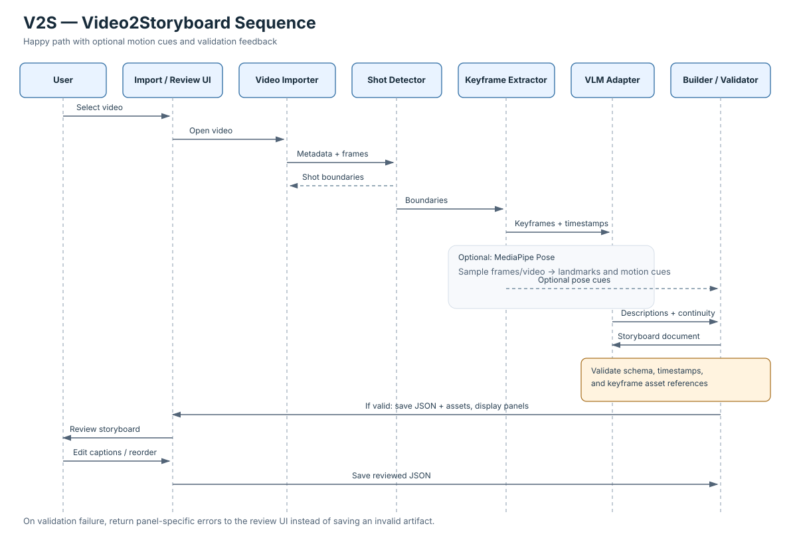
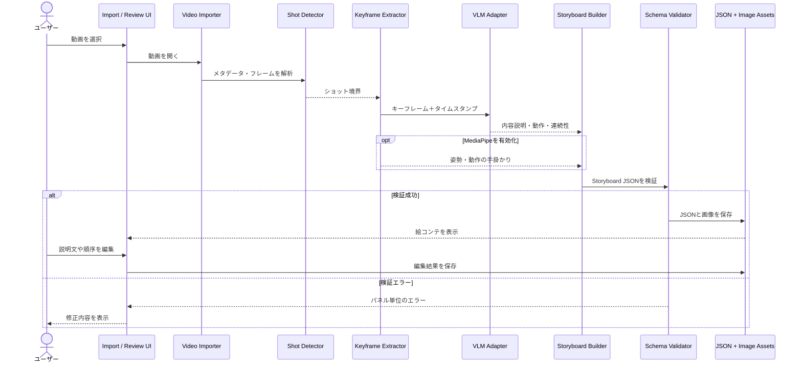

# video2storyboard

動画から、ショット単位の**絵コンテ（Storyboard）**を自動生成するための設計・実装プロジェクトです。動画を紙芝居動画に変換するのではなく、映像の流れを確認・編集できる「絵コンテ資料」を作ることを目的にします。

## LangGraph worker pipeline (implementation)

The executable worker graph lives in `src/video2storyboard/graph/`. All video-analysis workers are implemented in this repository; `visual-factory` is not a runtime dependency.



- **Workbench:** Kaggle datasets can provide reusable source videos. Google Colab is the interactive runtime; Google Drive is an optional persistent input/output location. Paths are supplied by the caller, not hard-coded.
- **video2png:** extracts sampled PNG frames and records frame IDs, timestamps, dimensions and aspect ratio.
- **Eye / pose:** Python MediaPipe Pose produces timestamp-linked landmarks. A missing detection is recorded as missing, never as a zero pose.
- **Eye / composition:** OpenCV (`cv2`) measures dimensions, aspect ratio, luminance and edge density. Semantic background/context is not fabricated by CV measurements; the VLM adapter supplies interpretation.
- **Eye / meaning:** `eye_meaning_vlm` accepts a provider adapter via `config["vlm_callable"]`. Configure this adapter for your selected VLM provider before expecting semantic descriptions.
- **Ear / STT:** FFmpeg extracts audio and `faster-whisper` emits timestamped transcript segments.
- **Hand / paper:** `hand_storyboard_builder` joins outputs by `frame_id` and timestamps. JSON is the structured source; HTML is the review surface; SVG is a portable visual rendering.
- **LangGraph:** modality workers fan out after frame extraction and join at an explicit barrier before storyboard assembly. The graph is defined in code, so diagrams should be generated from the actual StateGraph when updated.

### Run locally

```bash
python -m pip install -r requirements.txt
PYTHONPATH=src python -c "from video2storyboard.graph import app; print(app.get_graph().draw_mermaid())"
PYTHONPATH=src python -c "from video2storyboard.graph import app; result=app.invoke({'source_video':'/path/to/input.mp4','output_dir':'outputs','config':{'frame_interval_seconds':1.0}}); print(result.get('artifacts'), result.get('status'))"
```

For Colab, clone this repository, install `requirements.txt`, mount Drive, and pass the mounted video path as `source_video` and a Drive folder as `output_dir`. For Kaggle, pass the dataset file path and a writable `/kaggle/working` output directory.

**Backend note:** the VLM adapter is intentionally provider-neutral and must be configured. Worker errors are preserved in the output. Use a LangGraph checkpointer and a stable `thread_id` for resumable runs when the selected storage backend supports it.

---

## Python worker microservices

The graph's worker functions can also be deployed as isolated HTTP services using FastAPI. Each container exposes `GET /health` and `POST /run`; request bodies contain the graph state under `state`. Worker responses are returned under `result`. This is a worker-service layer, not yet a distributed workflow scheduler: callers or a future gateway are responsible for ordering calls and passing state between them.

| Service | Port | Worker |
|---|---:|---|
| ingest | 8001 | `ingest_video` |
| frames | 8002 | `video2png` |
| pose | 8003 | `eye_pose_mp` |
| composition | 8004 | `eye_composition_cv2` |
| meaning | 8005 | `eye_meaning_vlm` |
| stt | 8006 | `ear_stt_whisper` |
| storyboard | 8007 | `hand_storyboard_builder` |
| render | 8008 | `paper_html_svg` |
| validate | 8009 | `validate_storyboard` |

### Start the services

1. Install Docker Desktop and start local LM Studio if you want VLM analysis.
2. Put test videos under `./input/`; generated artifacts go under `./outputs/`.
3. Set `VIDEO2STORYBOARD_VLM_MODEL` to a vision-capable model ID from LM Studio.
4. Run:

```powershell
docker compose up --build -d
Invoke-RestMethod http://localhost:8001/health
```

Example worker call (input paths must be visible inside the containers, e.g. `/workspace/input/demo.mp4`):

```powershell
$body = @{ state = @{ source_video = "/workspace/input/demo.mp4"; output_dir = "/workspace/outputs"; config = @{ frame_interval_seconds = 1.0 } } } | ConvertTo-Json -Depth 8
Invoke-RestMethod -Method Post -Uri http://localhost:8001/run -ContentType "application/json" -Body $body
```

Use the relevant port for each worker. All services share the same mounted output directory so generated frame paths can be passed between calls. The VLM worker uses only the configured local LM Studio endpoint; no cloud fallback is provided. Do not expose these ports to an untrusted network without authentication and network controls.

Stop services with `docker compose down`. Run API tests with `PYTHONPATH=src python -m pytest -q`.

## 目的

- 動画を読み込み、シーン／ショットの境界を検出する
- 各ショットを代表するキーフレームを抽出する
- VLM（Vision-Language Model）で画面内容、動作、登場物、場面の連続性を説明する
- 構造化された Storyboard JSON と画像アセットを生成する
- HTMLビューアでパネル、説明文、順序を確認・編集し、各形式へ出力する

## 処理の流れ

1. **動画入力** — MP4 / MOV / WebM などを読み込み、FPS・長さ・解像度を取得
2. **ショット検出** — シーンの切り替わりを検出
3. **キーフレーム抽出** — 各ショットを代表するフレームを選び、重複や品質の低い画像を除外
4. **VLM解析** — フレームの内容、人物・物体、動作、構図、ショット間の連続性を文章化
5. **Storyboard生成** — タイムスタンプとキーフレームを紐づけ、Storyboard JSONを構築
6. **検証とレビュー** — スキーマ、時刻、画像参照を検証し、HTMLビューアで編集
7. **エクスポート** — JSON / HTML / PDF / PNG などの出力を想定

音声認識（ASR）やOCRは、台詞・字幕・画面内テキストを補足する任意の入力です。MediaPipe Poseも任意で利用でき、姿勢・動きの手掛かりを追加します。MediaPipeはVLMの代替ではなく、一般的な画面理解はVLMが担当します。

## システム構成図

SVGはREADME内でそのまま表示されます。Mermaidソースも併記しているため、GitHub上で表示を確認したり、図を編集したりできます。



- [SVGを開く](docs/v2s-architecture.svg)
- [Mermaidソース（.mmd）](docs/v2s-architecture.mmd)
- [PlantUMLソース（.puml）](docs/v2s-architecture.puml)

### Mermaidソース



## シーケンス図

こちらは、動画を選択してから絵コンテをレビュー・保存するまでのコンポーネント間のやり取りを示します。検証に失敗した場合は、不正なデータを確定せず、パネル単位のエラーをビューアへ返す設計です。



- [SVGを開く](docs/v2s-sequence.svg)
- [Mermaidソース（.mmd）](docs/v2s-sequence.mmd)
- [PlantUMLソース（.puml）](docs/v2s-sequence.puml)

### Mermaidソース



## 出力データの考え方

Storyboard JSONを正規データ（canonical artifact）として扱い、ビューアやエクスポーターはこのデータを読み書きする構成を目指します。画像はアセットとして別管理し、JSONから参照します。

各パネルに保持する情報の候補：

- パネルIDとショット番号
- 開始・終了タイムスタンプ
- キーフレーム画像の参照先
- 画面の説明、動作、登場物、構図
- 必要に応じた台詞・字幕・音声情報
- 解析モデル、生成日時、信頼度などのメタデータ

具体的なJSONスキーマ、VLMプロバイダー、ショット検出方式、HTMLビューアの実装は、今後の実装段階で確定します。上記の図は現時点の目標アーキテクチャです。

## 図のソース

| 種類 | 構成図 | シーケンス図 |
|---|---|---|
| Mermaid | [`v2s-architecture.mmd`](docs/v2s-architecture.mmd) | [`v2s-sequence.mmd`](docs/v2s-sequence.mmd) |
| SVG | [`v2s-architecture.svg`](docs/v2s-architecture.svg) | [`v2s-sequence.svg`](docs/v2s-sequence.svg) |
| PlantUML | [`v2s-architecture.puml`](docs/v2s-architecture.puml) | [`v2s-sequence.puml`](docs/v2s-sequence.puml) |

## OpenCode MCP (local-only)

The repository includes a stdio MCP server at `src/video2storyboard/mcp_server.py`. It exposes three tools to OpenCode:

- `video2storyboard_check_local` — checks Python dependencies, FFmpeg, and the local LM Studio model list without opening media.
- `video2storyboard_analyze` — runs the LangGraph workflow against an explicit local video path and writes artifacts locally.
- `video2storyboard_get_run` — summarizes the JSON/HTML/SVG files in a local run directory.

### Install and configure

From the repository root in PowerShell:

```powershell
python -m venv .venv
.\.venv\Scripts\python.exe -m pip install -r requirements.txt
$env:VIDEO2STORYBOARD_VLM_MODEL = "YOUR_VISION_MODEL_ID"
$env:LM_STUDIO_BASE_URL = "http://127.0.0.1:1234/v1"
.\.venv\Scripts\python.exe -m video2storyboard.mcp_server
```

The last command starts the MCP stdio process; normally OpenCode starts it for you. Keep LM Studio running with a vision-capable model loaded. To discover model IDs:

```powershell
Invoke-RestMethod http://127.0.0.1:1234/v1/models
```

Add the following MCP entry to your OpenCode configuration. Replace the example repository path and model ID with your actual values; use escaped backslashes or forward slashes in Windows paths.

```json
{
  "$schema": "https://opencode.ai/config.json",
  "mcp": {
    "video2storyboard": {
      "type": "local",
      "command": [
        "C:/path/to/video2storyboard/.venv/Scripts/python.exe",
        "-m",
        "video2storyboard.mcp_server"
      ],
      "environment": {
        "PYTHONPATH": "C:/path/to/video2storyboard/src",
        "LM_STUDIO_BASE_URL": "http://127.0.0.1:1234/v1",
        "VIDEO2STORYBOARD_VLM_MODEL": "YOUR_VISION_MODEL_ID"
      },
      "enabled": true
    }
  }
}
```

If your OpenCode version uses a different configuration location, merge only the `mcp.video2storyboard` entry into its existing config rather than replacing the whole file.

### Try it from OpenCode

1. Call `video2storyboard_check_local` and resolve any missing dependencies or model configuration.
2. Call `video2storyboard_analyze` with a short, non-sensitive local video path, for example `C:/Videos/sample.mp4`.
3. Call `video2storyboard_get_run` with the returned run directory (normally `<output_dir>/<run_id>`).

### Privacy and current limits

- The MCP server calls only the configured local LM Studio endpoint. It has no cloud VLM fallback and does not upload source video, frames, audio, or storyboards to cloud services.
- Only pass video paths you intend the local process to read. Generated artifacts remain on the selected local output path.
- FFmpeg must be installed separately and available on `PATH`.
- Whisper, MediaPipe, and OpenCV can fail independently; errors are returned in the run result.
- MCP integration and tests have been added, but do not treat them as locally verified until `python -m pytest -q` passes on your machine. A model appearing in `/v1/models` does not by itself prove vision support.

