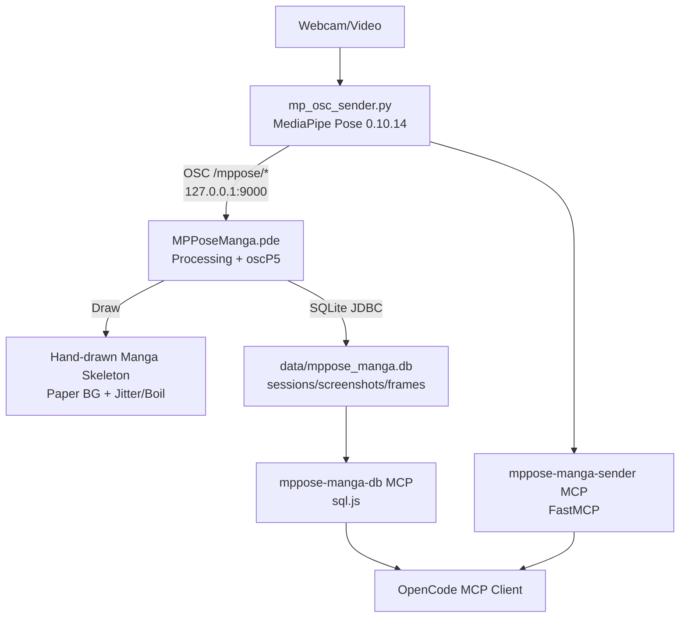

# mp-py + p5-java システム図

## 概要図 (Mermaid)

## PlantUML

[system.puml](./system.puml) を参�照してください。

## コンポーネント説明

| コンポーネント | 説明 |
|---|---|
| `mp_osc_sender.py` | MediaPipe Poseでポーズ検出し、正規化座標をOSCで送信 |
| `MPPoseManga.pde` | OSC受信して手描き風にポーズを描画。SQLiteにセッション/フレーム/スクリーンショットを記録 |
| `oscP5` | Processing用OSCライブラリア |
| `SQLite` | sessions, screenshots, frames テーブルで記録 |
| `mppose-manga-sender` | MCP経由でsenderの起動・停止・状態確認 |
| `mppose-manga-db` | MCP経由でDBをクエリ（sql.js使用、ビルド不要) |

## データフロー

1. カメラ/動画からフレーム取得
2. MediaPipe Poseでランドマーク検出（33点）
3. 正規化座標(x,y,z,visibility)をOSCで送信
4. Processingが受信して手描き風に描画（ジッター + 複数パス）
5. セッション開始時にDBに記録、30フレーム毎にフレーム記録、`s`キーでスクリーンショット保存
6. MCP経由でDB照会・sender制御が可能
